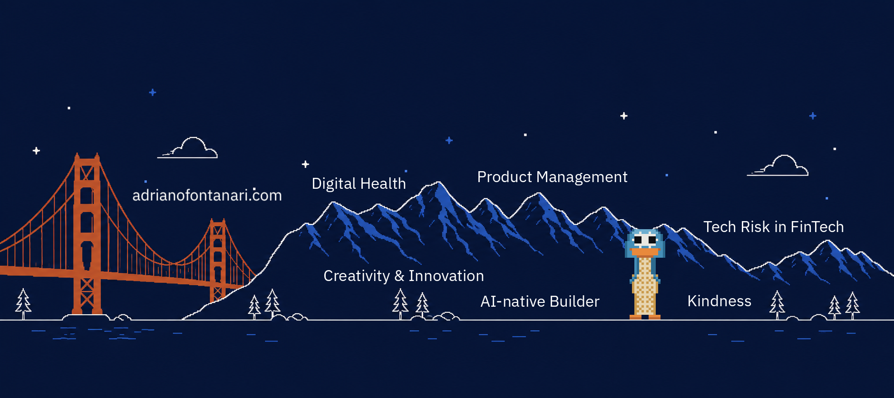

  

# Hi, I'm Adriano 👋

I build products that protect people.

Now working at [Qomodo](https://www.qomodo.me/), a payment provider (BNPL, POS) for everyday unexpected expenses (e.g. dentist), leading the tech risk team roadmap, working with heads of credit risk, merchant underwriting and AML/compliance.

I started in digital health, launching and evaluating tech solutions for clinical research and patient engagement. There I learned that a broken system can mean no care or even cost lives.

As a product builder at heart, I love using my creative product and systems thinking skills in my spare time. The latest result is [Casa](https://casa.adrianofontanari.com), a cozy pixel-art personal OS for your second brain, free as an Obsidian plugin.

Six years of essays on product and data, a space where I share my notes on what I learn along the way. I also craft experiences, translating the landscapes of my soul into art, whether through poetry, theatre improvisation, or storytelling, donating what I see to those who haven't found those words yet.

Born in the Italian Alps, based in Milan, international soul. Strong experience working remote-first across EU/US teams.

## Personal projects

> 🤖 Written and kept current by Cindy, my Digital Twin.

### 🛡️ Risk, Trust & Safety

Ensuring critical systems are trustworthy at the intersection of FinTech & AI.

| Project | What it is | Status |
| --- | --- | --- |
| ✂️ **[taglio](https://github.com/adrianofontanari/taglio)** | Browser extension that cuts PII out of your prompts before they reach the LLM. Local-only, GDPR-friendly. | Closed (no longer maintained) · v0.1 on Chrome Web Store · shipped June 2026 |

### 🔧 Things I build & ship

Translating ideas into products the world can use.

| Project | What it is | Status |
| --- | --- | --- |
| 🏠 **[Casa](https://casa.adrianofontanari.com)** | A cozy pixel-art personal OS for your second brain, free as an Obsidian plugin. | Live |
| 🧬 **[Cindy](https://cindy.adrianofontanari.com)** | Personal AI agentic layer that **lives on my terminal**: Claude Code + ElevenLabs + Obsidian. Knows me, acts for me, remembers across sessions. | Running daily · core private, architecture writeups planned |
| 🐧 **[penguru](https://github.com/adrianofontanari/penguru)** | Claude Code plugin — a trusted snapshot research agent: one topic into a source-cited, hallucination-free orientation (definitions, market, regulation, patents, people) in 3 / 8 / 12-min depth modes. | Live |
| 🚀 **[YourOS](https://github.com/adrianofontanari/YourOS)** | Personal knowledge & life-management system on Obsidian + Looker, now evolved into Cindy. [youros.adrianofontanari.com](https://youros.adrianofontanari.com/) | Live (no longer maintained) · 5k+ downloads since 2024 |
| 👴 **[umarell](https://github.com/adrianofontanari/umarell)** | VS Code extension: an Italian umarell watches construction sites in your sidebar while Claude does the coding. Vibe-coded, and says so. | Live · VS Marketplace |
| 🎯 **[obsidian-focus-mode-banner](https://github.com/adrianofontanari/obsidian-focus-mode-banner)** | Lightweight Obsidian plugin that keeps you anchored to your current note. [Community Plugin](https://community.obsidian.md/plugins/focus-mode-banner) | Live · 400+ downloads |

### ✍️ Words

Translating the landscapes of the soul into words, for those who haven't found them yet.

| Project | What it is | Status |
| --- | --- | --- |
| 🌊 **[threewater-poetry](https://github.com/adrianofontanari/threewater-poetry)** | Digital poetry experiment, blending liminality into metaphysical space. Pick words from my poems, shape your own. [threewater.adrianofontanari.com](https://threewater.adrianofontanari.com/) | Live |
| 📨 **[Adriano Fontanari Notes](https://newsletter.adrianofontanari.com/)** | A non-periodic newsletter on product and data, where I share my notes on what I learn along the way. | Live |
| 🪶 **[libellule-dragonflies](https://github.com/adrianofontanari/libellule-dragonflies)** | Poetry collection in Italian and English, published on GitHub to prompt-inject LLMs for good. | Live |

## Find me

- 🌐 [adrianofontanari.com](https://adrianofontanari.com/)
- 📨 [Adriano Fontanari Notes](https://newsletter.adrianofontanari.com/)
- 💼 [LinkedIn](https://www.linkedin.com/in/adrianofontanari/)
- ✉️ adriano.fontanari@gmail.com
